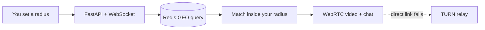

<div align="center">


<br/><br/>

[](https://nearhi.cybernetic.co.in)
[](https://mitra.cybernetic.co.in)
[](https://www.linkedin.com/in/sachin-gupta-82909926b)
[](https://kaggle.com/sachingupta07)
[](mailto:sachingupta1437@gmail.com)


</div>

<br/>

<div align="center">

## ⭐ Now Live: NearHi

### Talk to people near you. Set a radius, get matched inside it.

<sub>Random text and video chat, but local. You pick how far you want to reach, and NearHi only pairs you with people within that distance.</sub>

<br/><br/>

[](https://nearhi.cybernetic.co.in)

<!-- Add a screenshot or GIF here once you have one:

-->

</div>

<br/>



<table>
<tr>
<td width="33%" valign="top" align="center">

**📍 Radius matching**<br/>
Redis geo queries pair you with users inside the distance you choose

</td>
<td width="33%" valign="top" align="center">

**🎥 Peer-to-peer video**<br/>
WebRTC connection with a TURN relay as the fallback

</td>
<td width="33%" valign="top" align="center">

**⚡ Real-time chat**<br/>
WebSocket signaling and messaging, deployed on Railway

</td>
</tr>
</table>

<div align="center">

`FastAPI` `Redis` `WebRTC` `WebSocket` `Railway`

</div>

---

## 👨‍💻 About Me

Final-year MCA student at LPU. I build AI systems that run in production, not just in a notebook, and I think about privacy before the first line of code.

```python
sachin = {
    "building"   : ["NearHi", "Mitra", "IERS", "SignBridge"],
    "focus"      : "AI systems that are deployed, not just demoed",
    "principle"  : "privacy-first, thought through before it ships",
    "stack"      : ["Python", "FastAPI", "React", "YOLOv8", "PyTorch", "WebRTC"],
    "off_screen" : "Trekking in the Himalayas 🏔️",
    "reach_me"   : "linkedin.com/in/sachin-gupta-82909926b | sachingupta1437@gmail.com"
}
```

---

## 🔨 Featured Projects

### 🧠 Mitra: a privacy-first AI companion

> An AI friend built around real privacy guarantees instead of a privacy policy. Multilingual from day one, with an AR avatar in progress.

| | |
|---|---|
| 🔐 **Encrypted** | End-to-end encryption on conversation data |
| 🚨 **Crisis-aware** | Dedicated detection layer, adversarially tested |
| 🕶️ **Incognito mode** | Fully custom UI for private sessions |
| 🌍 **Multilingual** | Built in from the start |

[](https://mitra.cybernetic.co.in) `FastAPI` `React` `Firebase` `Gemini` `Three.js` `WebXR`

*Repo is private.*

<br/>

<table>
<tr>
<td width="50%" valign="top">

### 🚨 IERS
**Intelligent Emergency Recognition System**

> Multi-class threat detection on YOLOv8, covering fire and smoke today with weapons, people, and accidents on the way. A layered suppression system (temporal filtering, zone rules) keeps false alarms down.

- 🖥️ FastAPI backend + React/Vite dashboard
- 💻 Packaged desktop app (PyWebView + PyInstaller)
- 🧱 Pipeline built to add new threat classes

[](https://github.com/sachin1437/IERS)
[](https://huggingface.co/spaces/sachingupta07/IERS)

`YOLOv8` `FastAPI` `React` `OpenCV` `Docker`

</td>
<td width="50%" valign="top">

### 🤟 SignBridge
**Indian Sign Language recognition**

> Real-time ISL recognition from webcam input, built to close an accessibility gap for the hearing impaired.

- 🖐️ MediaPipe Holistic landmarks into a BiLSTM
- 🎯 90.6% accuracy across 19 gesture classes
- 🗂️ Custom-collected gesture dataset
- 📄 Research write-up with my supervisor

[](https://github.com/sachin1437/SignBridge-AI)

`MediaPipe` `PyTorch` `BiLSTM` `OpenCV`

</td>
</tr>
<tr>
<td width="50%" valign="top">

### 📋 Atmos
**Face recognition attendance**

> Attendance for colleges with liveness detection, built with a team of five. No paper registers, no proxy attendance.

**My part (ML and anti-spoofing):**
- 👤 ArcFace face recognition pipeline
- 👁️ Eye-aspect-ratio liveness check
- 🗄️ Django backend integration

[](https://github.com/govindsingh00/attendance-system)

`Django` `ArcFace` `MediaPipe` `MySQL`

</td>
<td width="50%" valign="top">

### 🧭 What's Next

```
▸ NearHi: public launch, moderation tools
▸ Mitra: AR avatar (WebXR), more languages
▸ IERS: multi-signal threat correlation
▸ SignBridge: wider gesture vocabulary
▸ Open-sourcing pieces of the stack
```

</td>
</tr>
</table>

---

## 🗂️ More Projects

| Project | What it is | Stack |
|---|---|---|
| **QR Restaurant Ordering** | Table-side QR ordering system, still in daily use | Web |
| **FareForward** | Peer-to-peer ticket resale platform, proposal sent to DPIIT | PHP, MySQL |
| **ATM Cash Forecasting** | Cash replenishment forecasting with a Streamlit demo | LightGBM, Streamlit |
| **Customer Churn Prediction** | Churn model published on Kaggle | scikit-learn |
| **PharmaGo** | Pharmacy management desktop app | Java, Swing, MySQL |

---

## 🛠️ Tech Stack

<div align="center">


<br/>


<sub>Also: YOLOv8, MediaPipe, WebRTC, Three.js, Streamlit</sub>

</div>

---

## 📊 GitHub Stats

<div align="center">


</div>

---

## 📜 Certifications

<div align="center">

[](https://www.linkedin.com/in/sachin-gupta-82909926b)
[](https://www.linkedin.com/in/sachin-gupta-82909926b)
[](https://www.linkedin.com/in/sachin-gupta-82909926b)
[](https://www.linkedin.com/in/sachin-gupta-82909926b)

</div>

---

<div align="center">

[](https://github.com/sponsors/sachin1437)


*"Ship it. Iterate. Repeat."*

</div>
